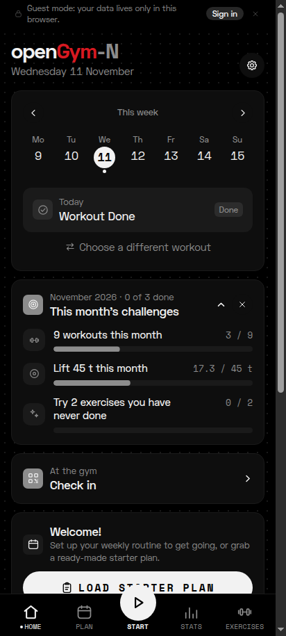
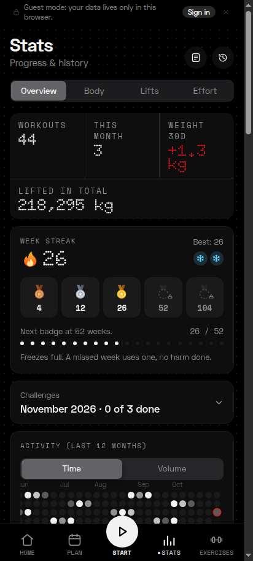
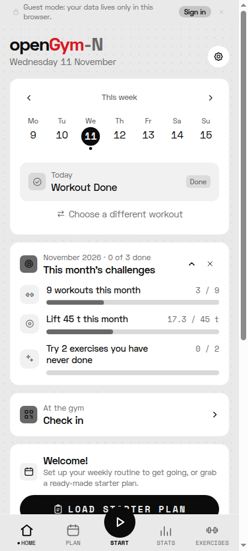

<div align="center">

# openGym-N

**openGym with a Nothing-style "glyph" look: black, white dots, one red, dot-matrix numbers.**

<p>



</p>

</div>

openGym-N is a fork of [openGym](https://github.com/DuarteSantos8/openGym), the self-hosted gym and
body-weight tracker. It is a **reskin only**: every screen, function, the navigation and your data are
the same as upstream. What changes is the look, inspired by Nothing OS, and the Android package, so it
installs next to the official app.

This is an unofficial personal project. It is not affiliated with or endorsed by Nothing Technology
Limited or by the openGym authors.

## What is different

- **Glyph design language.** Pure black background with a faint dot grid, white dots, a single red
  (`#D71921`) that only marks what is live: the set in progress, a running rest timer, a record.
  A light glyph theme is available too. The accent colour picker and the seasonal themes are turned off.
- **Dot-matrix numbers.** Headline numbers (totals, streak, recap) use Doto. Numbers below 26 px use
  Space Mono, and text uses Space Grotesk, so tables stay readable mid-workout. All three fonts are
  bundled (OFL, see `frontend/src/fonts/OFL.txt` and `NOTICE.md`), nothing loads from the network.
- **Dot-matrix charts.** Bar charts, line charts, the heatmap, the rest timer and the streak are drawn
  with dots, with the same data and the same touch behaviour as before.
- **Own identity on Android.** App name `openGym-N`, id `io.github.vandrovisky.opengymn`, a dumbbell
  icon drawn in dots (with a themed-icon layer for Nothing OS), black splash.
- **No self-update.** The in-app updater points at the upstream releases, so it is switched off here.
  You install new APKs by hand.

The design notes and the decisions behind them are in
[docs/superpowers/specs/2026-11-11-glyph-skin-design.md](docs/superpowers/specs/2026-11-11-glyph-skin-design.md).
The look is isolated in `frontend/src/glyph.css` (plus a few chart components), which keeps merges from
upstream small.

## Build the Android APK

You need Node 22, JDK 21 and the Android SDK (platform 36, build-tools 36.0.0).

```bash
cd frontend
npm ci
npm run build:mobile                # web build + exercise media (180 px) + cap sync
cd android
echo "sdk.dir=$HOME/Android" > local.properties
./gradlew assembleSideloadDebug     # app/build/outputs/apk/sideload/debug/
adb install -r app/build/outputs/apk/sideload/debug/*.apk
```

The debug build has the id `io.github.vandrovisky.opengymn.test`. For a release build, sign it with
your own keystore and keep that keystore out of the repository.

Without a server, your data lives only on the phone (local storage mirrored to a file in the app's
storage). Uninstalling the app or clearing its data erases it, so use the backup export in Settings now
and then. See the [upstream docs](docs/README.upstream.md) to self-host a server and sync.

## Credits and licence

- [openGym](https://github.com/DuarteSantos8/openGym) by its authors, licensed AGPL-3.0-or-later, as is
  this fork. The original README is kept in [docs/README.upstream.md](docs/README.upstream.md).
- Layout reference: [glyph-rice](https://github.com/vandrovisky/glyph-rice). Fonts Doto, Space Grotesk
  and Space Mono are licensed under the SIL Open Font License.
- The exercise media are licensed separately (see `NOTICE.md`). Only the 180 px files that are already in
  the repository are used here, and the screenshots above show none of them.
